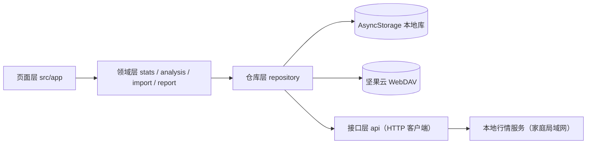
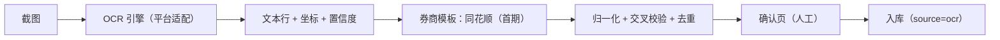

# 交易记录与复盘应用产品规划

> 定位：个人 A 股投资者的交易记录、行为诊断与周期复盘工具  
> 技术基线：Expo 58 / React Native / Web 双端，本地优先，坚果云 WebDAV 同步  
> 服务端配套规划：`lianghua/docs/行情数据服务规划.md`  
> 本文只做规划，不涉及代码改动。

---

## 1. 产品定位

> 记录只是入口，**改善交易行为**才是产品价值。

产品闭环：

```
记录（现有） → 图片导入（降低记录成本） → 行情对接（提供客观参照）
      → 行为分析（发现问题） → 复盘报告（形成改进闭环）
```

四件事不是并列功能，而是一条价值链：

- **图片导入**解决“记录成本高 → 数据不全 → 分析不可信”的源头问题；
- **行情对接**提供客观参照系，避免分析变成主观评判；
- **行为分析**是产品差异化核心；
- **复盘报告**是分析结果的交付物与留存载体。

### 1.1 目标用户

- 有多个证券账户、交易频率中等、愿意复盘的个人投资者。
- 关注“我为什么亏/赚”，而不只是“我赚了多少”。

### 1.2 产品边界（本期不做）

- 不做投资建议、买卖推荐、收益预测。
- 不做多人协作、社交、跟单。
- 不做实时行情、Level-2、自动交易、券商接口直连。
- 不接量化策略/回测/选股模块。
- 不把交易数据默认上传到服务端（隐私与信任边界）。
- **交易截图不上传服务端**：识别在设备本地完成，无网可用。

---

## 2. 现状基线

### 2.1 已有能力

| 模块 | 现状 | 对规划的意义 |
|---|---|---|
| 交易记录 | 账户 → 股票 → 买卖/股息流水，做T关联 | 领域模型已成型，是分析的数据底座 |
| 收益口径 | `src/data/stats.ts` 为唯一权威实现，含建仓周期、清仓收益、做T分摊 | 分析层必须复用，不得另算一套 |
| 计划交易字段 | `expectedRange` / `expectedBuyLow/High` / `expectedSellLow/High` | **已具备“计划纪律”分析的数据基础**，价值被低估 |
| 同步 | 坚果云 WebDAV，整包 JSON 上传/下载 | 多端一致性弱，整包覆盖，后续需合并策略 |
| 设置 | 设备 ID、WebDAV 配置、上传/覆盖下载 | 后端地址等新配置可复用该页面结构 |

### 2.2 关键架构约束

1. 交易数据只存在本机 `AsyncStorage`，WebDAV 是唯一跨端通道。
2. 主键是**每台设备各自自增的数字 ID**，多端合并或接后端必然冲突——头号技术债。
3. 统计口径已定：总收益 = 持仓收益 + 清仓收益；全部股息计入清仓收益。分析与报告只能在其上派生。
4. 页面不得直接发 HTTP 请求，数据读写统一走 `TradeProvider` 与仓库层。
5. 不修改 `lianghua/`；服务端能力由其独立规划推进。

---

## 3. 客户端总体架构

### 3.1 分层



| 层 | 职责 | 禁止事项 |
|---|---|---|
| 页面层 `src/app/` | 展示、交互、导航 | 不写收益/分析算法，不直接 `fetch` |
| 领域层 `src/data/*` | 纯 TS：统计、分析、解析归一、报告组装 | 不依赖 React / RN 原生模块 |
| 仓库层 `src/data/repository/` | 本地读写、远端读写、缓存、降级 | 不包含业务口径 |
| 接口层 `src/data/api/` | HTTP 客户端、DTO 映射、错误归一 | 不做展示逻辑 |

### 3.2 前端技术决策

| 编号 | 决策 | 结论 | 理由 |
|---|---|---|---|
| D1 | 分析在哪算 | **客户端纯 TS** | 个人级数据量；可离线、可测试、隐私不外传 |
| D2 | 报告在哪生成 | **客户端组装，LLM 仅可选润色** | 数字必须可追溯到本地数据 |
| D3 | 交易数据是否上服务端 | **本期不上**，保持本地 + WebDAV | 服务端无鉴权、单机定位；交易数据是隐私核心 |
| D4 | OCR 在哪做 | **端上离线解析，客户端确认** | 截图隐私不出设备；无网可用；服务端仅提供行情 |
| D5 | 多端一致性 | 短期“单写多读 + 显式覆盖”，中期实体级合并 | 整包覆盖会丢数据，需先补数据模型 |
| D6 | 行情服务地址 | **设置页可配置，默认留空由用户填写** | 服务部署在家庭局域网，地址因家庭网络而异，不能写死 |

---

## 4. 前置工程：数据模型 v2

> 唯一“用户看不见但必须先做”的任务。跳过它，后续四个功能都会返工。

### 4.1 必改项

| 变更 | 说明 |
|---|---|
| 稳定 ID | `Account/Stock/TransactionTrade/TTrade` 的 `id` 改为字符串 UUID；旧数字 ID 仅用于迁移映射 |
| 审计字段 | 增加 `updatedAt`、`deletedAt`（软删除墓碑）；移除硬删除 |
| 来源字段 | 交易增加 `source: 'manual' \| 'ocr' \| 'import'`、`sourceRef`（本地图片哈希 + 模板 ID） |
| 幂等键 | 增加 `dedupeKey`（股票+日期+方向+数量+价格+费用归一化） |
| 可选时间 | 交易增加可选 `time`（HH:mm），供 OCR 导入与日内择时分析；手工录入可不填 |
| 股息符号 | `dividend` 允许负数表示“股息红利税补缴”；`type='股息'`、`shares=0`、`price=0`，note 标明来源 |
| 快照元信息 | `TradeState` 增加 `schemaVersion: 2`、`deviceId`、`revision`、`updatedAt` |
| 迁移 | `migrateV1ToV2()` 纯函数 + 单元测试；旧 WebDAV v1 文件自动升级；保留 `legacyId` 映射 |
| 合并策略 | 同步从“整包覆盖”升级为“按实体合并”：`updatedAt` 新者胜，`deletedAt` 传播删除；冲突写本地冲突日志 |

### 4.2 涉及文件

- `src/data/types.ts`：v2 模型与类型守卫
- `src/data/state.ts`：软删除、UUID、合并函数
- `src/data/storage.ts`：迁移写回、schemaVersion 校验
- `src/data/sync.ts`：v1/v2 兼容、合并式下载
- `src/data/trade-context.tsx`：动作签名调整
- `src/data/*.test.ts`：迁移、合并、幂等、冲突用例

### 4.3 验收标准

- 旧版 WebDAV 文件可无损升级，升级后六项收益指标与升级前完全一致（固定数据集回归）。
- 两台设备分别新增交易 → 上传/下载后可合并，双方数据都不丢。
- 删除在合并后不会被“复活”。
- `typecheck`、`test`、`export:web`、Android bundle 全部通过。

---

## 5. 后端对接（客户端侧）

### 5.1 目标

获得客观行情参照，为择时分析、基准对比、复盘报告提供事实依据；同时不把交易隐私交给服务端。

### 5.2 客户端设计

- 设置页新增「行情服务」：**服务地址（必填）、连接测试、超时、缓存开关、最近连通时间**。
- 默认地址留空，由用户填写家庭局域网地址，例如 `http://192.168.1.10:8000`；不使用 `localhost`（Android 端指向手机自身）。
- `src/data/api/client.ts`：可配置 `baseUrl`、超时、错误归一（网络/HTTP/业务三类）。
- `src/data/api/market.ts`：
  - `searchStocks(q)` → `GET /api/stocks?q=`
  - `fetchKline(code, from, to)` → `GET /api/stocks/{code}/kline?from=&to=`
  - `fetchDatasets()` → `GET /api/datasets`（判断数据新鲜度）
  - `fetchHealth()` → `GET /api/health`
- 连接测试：保存前先请求 `/api/health`，失败时明确提示“地址不可达 / 服务未启动 / 不在同一局域网”。
- 缓存：按 `code + 区间 + 复权类型` 缓存到 AsyncStorage，带 TTL；离线读缓存并标注“数据截至 X 日”。
- 降级：服务不可达时，依赖行情的功能**显式标注“未连接行情”**，不得静默给出错误结论。
- 网络边界：仅家庭局域网访问；不暴露公网；地址由用户配置，不在代码里写死。

> 服务端接口契约、局域网监听与 CORS 配置，以 `lianghua/docs/行情数据服务规划.md` 为准。

### 5.3 界面落点

- 个股详情：最近 60 日 K 线、成本线、买卖点、数据截止日。
- 新建/编辑股票：支持后端股票搜索选择，减少代码/名称录入错误。
- 首页或设置页：服务连通状态与数据新鲜度提示。

### 5.4 验收标准

- 设置页可测试连接并显示健康状态。
- 断网时行情区显示缓存或占位说明，页面无报错、无 NaN。
- 所有请求经仓库层，页面无直接 `fetch`。
- 新增依赖只用 `npx expo install`。

---

## 6. 图片识别导入（端上离线）

### 6.1 用户问题

手工录入是最大使用阻力：一笔交易要填日期、方向、价格、数量、手续费，券商流水又分散。**录入成本高 → 数据不全 → 分析与复盘失真**。

### 6.2 已确认决策

| 决策 | 结论 |
|---|---|
| 识别位置 | **设备本地离线识别**，截图不上传服务端 |
| 首期券商 | **同花顺**（已提供 17 张样本）；**雪球、腾讯自选股暂缓** |
| 入库方式 | 识别结果只作候选，必须人工确认后入库 |
| 失败策略 | 宁可留空并高亮，不猜测字段 |

产品原则：

1. **离线优先**：飞行模式下也能完成导入；服务端只提供行情，不参与识别。
2. **识别是辅助，确认是必须**：任何图片都不得自动入库。
3. **可追溯**：每笔导入保留来源（本地图片哈希、模板 ID、原始文本）。
4. **可纠错**：确认页支持逐字段修改、勾选/忽略、合并重复。
5. **可替换**：OCR 引擎与解析规则解耦，后续可换引擎或增加端上模型，不影响确认与入库链路。

### 6.3 离线识别架构



| 层 | 职责 | 要求 |
|---|---|---|
| OCR 适配层 | 图片 → 文本行（含坐标） | 平台无关接口，Android/Web 各自实现 |
| 解析层 | 文本行 → 候选交易 | 纯 TS，可用固定文本样本单测，不依赖 OCR 引擎 |
| 归一化层 | 代码映射、方向、数量、费用、去重 | 纯函数，可单测 |
| 确认层 | 展示、编辑、勾选、入库 | 不得自动提交 |

OCR 接口建议：

```ts
interface OcrLine {
  text: string
  x: number
  y: number
  width: number
  height: number
  confidence: number
}

interface OcrEngine {
  recognize(imageUri: string): Promise<OcrLine[]>
}
```

平台实现：

| 平台 | 方案 | 说明 |
|---|---|---|
| Android | ML Kit 中文文本识别（通过 Expo 配置插件或兼容 RN 模块） | 离线、速度快；接入前必须核对其对 Expo 58 / RN 0.88 的兼容性 |
| Web | Tesseract.js（中文 `chi_sim`）或 PaddleOCR ONNX | 首次加载语言包后由浏览器缓存；需评估包体积与识别耗时 |
| 测试 | 固定文本行 fixture | 解析与归一化不依赖真实 OCR，保证可测试 |

> OCR 引擎必须在接口后隔离。若端上精度不达标，后续可增加“用户显式开启的服务端兜底”，但默认不上传、不联网识别。  
> 引擎选型过程、候选方案对比与推荐结论见 `everything/docs/交易截图OCR引擎选型分析.md`。

### 6.4 客户端流程

```
选择/拍摄截图（1~9 张）
   → 本地压缩与裁剪
   → 端上 OCR（文本行 + 坐标）
   → 券商模板匹配（同花顺，首期）
   → 字段抽取与交叉校验
   → 归一化：代码映射、方向、数量、费用、去重
   → 确认页：逐条勾选 / 编辑 / 忽略 / 指定账户与股票
   → 批量写入（带 source、sourceRef、dedupeKey）
   → 结果页：成功 N 条、跳过重复 M 条、失败 K 条（可重试）
```

全程无网络请求；行情服务不可用不影响导入。

### 6.5 同花顺对账单模板要点（首期）

> 已提供 17 张真实截图（`assets/ocr/同花顺`），均为浙商证券对账单版式。完整字段映射、行语法与样本覆盖见 `同花顺对账单截图解析规格.md`。雪球、腾讯自选股暂缓，待后续样本再设计。

| 项目 | 规则 |
|---|---|
| 表格锚点 | 表头 `操作` / `价格/数量` / `金额/费用` |
| 行块结构 | 操作名+徽标+时间 / 价格+数量 / 金额+费用，按纵坐标聚成一行 |
| 股票代码 | **截图不含代码**，只能用股票名称查本地字典；处理 `XD/XR/DR/ST` 前缀 |
| 买卖方向 | 以 `买入/卖出/证券买入/证券卖出` 文字为准；金额符号只作交叉校验 |
| 费用 | 金额含费用，可反推并与费用列交叉校验；费用列应为数值，异常值标记待确认 |
| 股息入账 | `type=股息`，`shares=0`，`dividend=金额`；价格列是分红参数，**不是成交价** |
| 股息红利税补缴 | `type=股息`，`dividend` 为负数，note 标明“红利税补缴” |
| 非交易流水 | `银行转存/转取`、`申购配号` 跳过并在结果页提示 |
| 跨图去重 | 同一账户多张截图大量重叠，按 `名称+日期+类型+数量+价格+费用` 去重 |
| 账户识别 | 从 `浙商证券 *4768` 提取券商名与尾号，匹配本地账户 |

其他规则：

- 不依赖红/蓝颜色判断方向，深色与浅色主题都需支持。
- 顶部/底部截断的行不自动勾选；状态栏、通知图标不参与识别。
- 金额与 `价格 × 数量` 不一致时标记“待人工确认”。
- 同一行字段不得跨行错配；无法确定归属的字段一律置空。

### 6.6 归一化与去重

- 股票映射优先级：本地已建股票 → 本地内置股票字典（由行情服务导出的代码/名称生成，联网时可刷新）→ 要求手动选择。
- 方向：`买入/证券买入/担保品买入` → 买入；`卖出/证券卖出` → 卖出；`红利/股息/派息` → 股息。
- 数量：买入手工模型为正值，卖出取负值，股息为 0。
- 费用：佣金 + 过户费 + 印花税（卖出）合并为 `commission`；分列时保留明细文本供确认页展示。
- 去重：`dedupeKey = hash(code + date + type + shares + price(±0.01) + commission(±0.5))`；同键已存在默认跳过，可强制导入。
- 幂等：同一图片（哈希）+ 模板 + 行号重复导入不产生重复记录。

### 6.7 页面与依赖

- `src/app/import/index.tsx`：入口、图片选择、本地解析进度
- `src/app/import/review.tsx`：候选确认（核心页面）
- 首页与个股详情增加「图片导入」入口
- 依赖：
  - `expo-image-picker`（相册/拍照/Web 文件选择）
  - `expo-image-manipulator`（压缩裁剪）
  - Android OCR 模块：选型前必须核对 Expo 58 兼容性，优先 Expo 配置插件
  - Web OCR：`tesseract.js` + 中文语言包（首次加载后缓存）
- 包体积：Web 中文语言包约十余 MB；Android 使用系统/ML Kit 模型，需在构建后实测增量。

### 6.8 验收标准

- **飞行模式下**完成“选图 → 识别 → 确认 → 入库”全流程。
- 用已提供的 17 张同花顺截图（浙商证券版式、深色/浅色、股息/税补缴/银证转账/申购配号）做基准集：关键字段级准确率 ≥ 95%；低置信字段必须高亮。
- 确认页可编辑全部字段，未确认记录绝不入库。
- 同一批图片重复导入不新增记录。
- 导入记录带 `source=ocr` 与 `sourceRef`（图片哈希 + 模板 ID），可在交易详情查看。
- 单张失败可单独重试，不阻塞整批。
- 抓包/网络日志确认：导入过程无截图上传请求。
- 目标性能：单张截图端到端 ≤ 5 秒（中端 Android），9 张批量可接受等待；Web 首次加载语言包除外。

### 6.9 风险

| 风险 | 影响 | 缓解 |
|---|---|---|
| 端上 OCR 精度不足 | 识别率低 | 模板 + 交叉校验 + 低置信高亮 + 人工确认；保留引擎替换空间 |
| 券商版式/字段变化 | 解析失败 | 模板版本化；用真实样本做 Golden Test；失败不阻断整批 |
| Web 语言包体积与耗时 | 首次体验差 | 按需加载、浏览器缓存、显示进度；必要时提示改用 Android |
| 设备性能差异 | 解析慢 | 图片先压缩；限制单批数量；异步处理并显示进度 |
| 股票字典过期 | 代码/名称映射错误 | 联网时刷新；映射失败强制手动选择 |
| 截图隐私 | 泄露 | 全程本地处理；不请求网络；同步文件不含图片 |
| Expo 原生模块兼容性 | 构建失败 | 只用 `npx expo install`；接入前查 Expo 58 文档；必要时改用 Web/WASM 方案 |

---

## 7. 交易行为分析

### 7.1 目标

把“感觉最近做得不好”变成**可量化、可追溯、可行动**的诊断。核心不是打分，而是**用证据指出具体行为模式**。

### 7.2 分析维度与指标

| 维度 | 指标 | 定义 / 计算 | 数据来源 |
|---|---|---|---|
| 计划纪律 | 计划覆盖率 | 填写了预期区间的交易 / 全部交易 | 本地 `expected*` |
| 计划纪律 | 区间遵守率 | 成交价落在预期区间内的比例 | 本地 |
| 计划纪律 | 偏离幅度 | 区间外成交的加权偏离百分比 | 本地 |
| 择时质量 | 买入分位 | `(当日最高 − 成交价) / (当日最高 − 最低)`，越高越接近低点 | 日K raw |
| 择时质量 | 卖出分位 | `(成交价 − 当日最低) / (当日最高 − 当日最低)`，越高越接近高点 | 日K raw |
| 择时质量 | 买卖价差 | 同一股票相邻买卖的价差与持有天数 | 本地 + 日K |
| 做T表现 | 做T胜率 / 贡献 | 复用 `tTradeDetails`，统计盈利笔数与收益占比 | 本地 |
| 周期质量 | 胜率、盈亏比 | 已平仓周期盈利数占比；总盈利 / 总亏损绝对值 | 本地（需抽出周期边界） |
| 周期质量 | 平均持有天数 | 建仓到清仓的自然日 | 本地 |
| 周期质量 | 最大回撤 | 持仓期间收盘价相对峰值最大跌幅 | 日K qfq |
| 处置效应 | 盈亏持有天数差 | 盈利周期平均持有天数 vs 亏损周期 | 本地 |
| 追高/恐慌 | 追高买入率 | 买入价处于近 20 日价格区间高分位（如 >80%）的比例 | 日K |
| 追高/恐慌 | 下跌卖出率 | 卖出前 5 日累计跌幅超过阈值的比例 | 日K |
| 过度交易 | 月均交易笔数 | 按自然月统计 | 本地 |
| 成本侵蚀 | 费用收益率 | 累计手续费 / 累计已实现收益 | 本地 |
| 集中度 | 单股最大占比 | 单股持仓成本 / 账户总持仓成本 | 本地 |
| 基准对比 | 区间超额 | 持仓期间个股 qfq 收益 − 同期指数收益 | 日K + 指数（由服务端补充） |

> 口径纪律：所有收益数字必须来自 `stats.ts`；分析层只派生“比率/分位/天数”，不得另算金额收益。

### 7.3 评分卡

六个维度，各 0–100，加权总分：

| 维度 | 权重建议 | 说明 |
|---|---|---|
| 计划纪律 | 25% | 是否有计划、是否执行 |
| 择时质量 | 20% | 买卖点相对当日/近期区间 |
| 周期质量 | 20% | 胜率、盈亏比、回撤 |
| 成本控制 | 15% | 费用占比、交易频率 |
| 风险集中 | 10% | 单股/单账户集中度 |
| 做T质量 | 10% | 做T胜率与贡献 |

规则：

- **样本不足不给分**：已平仓周期 < 5 时显示“样本不足”，只展示原始指标。
- 评分必须可解释：每个分数附带指标、样本量、阈值。
- 不做“好坏人设”，只做同一个人历史纵向对比。
- 文案只描述事实与模式，不出现“建议买入/卖出”。

### 7.4 洞察规则引擎（示例）

| 规则 | 触发条件 | 输出 |
|---|---|---|
| 追高买入 | 近 20 日分位 > 80% 的买入占比 > 40% | “X 笔买入位于近 20 日高位区间” |
| 卖飞 | 卖出后 5 日收盘涨幅中位数 > 5% | “Y 笔卖出后 5 日继续上涨，中位 +Z%” |
| 扛亏 | 亏损周期持有天数 / 盈利周期 > 1.5 | “亏损单平均持有天数显著更长” |
| 过度交易 | 月均笔数 > 个人历史 75 分位 | “本月交易频率处于历史高位” |
| 费用侵蚀 | 费用 / 已实现收益 > 15% | “手续费占已实现收益 X%” |
| 计划外交易 | 未填预期区间占比 > 50% | “超过一半交易没有事前计划” |
| 做T无效 | 做T胜率 < 40% 且贡献为负 | “做T累计贡献 −X” |

每条洞察必须附带：证据交易 ID、样本量、时间范围，可点击跳转到对应交易。

### 7.5 页面与交互

- 新增底部 Tab：`记录` / `分析` / `复盘` / `设置`（现有 Stack 页面迁入 Tab 组）。
- 分析页：时间范围（近 1 月/3 月/1 年/全部）、账户筛选、评分卡、维度卡、洞察列表、证据下钻。
- 个股详情增加「行为画像」区块：买卖分位、周期质量、做T表现。
- 依赖行情的指标在不可达时显示“需连接行情”，而非 0 分。

### 7.6 验收标准

- 纯函数指标层 `src/data/analysis/` 有完整单测：正常、空数据、样本不足、除零、停牌（high=low）、跨年、除权。
- 指标结果与手工核算样例一致（固定 3 组交易序列，含做T与股息）。
- 分析页无行情时优雅降级，不出现 NaN / Infinity。
- 每条洞察可定位到具体交易，样本量透明。

---

## 8. 复盘报告

### 8.1 报告类型

| 类型 | 触发 | 内容重点 |
|---|---|---|
| 单笔/周期复盘 | 个股页手动生成 | 计划 vs 执行、买卖分位、持有期回撤、做T贡献、经验条目 |
| 周复盘 | 手动/定时 | 本周盈亏、主要贡献与拖累、纪律违规、评分变化 |
| 月复盘 | 手动/定时 | 收益归因、胜率盈亏比、费用、集中度、下月检查清单 |
| 阶段/年度复盘 | 手动 | 净值曲线、最大回撤、基准对比、行为演变 |
| 自定义区间 | 手动 | 任意时间段同口径汇总 |

### 8.2 报告结构

1. **结论摘要**：3 条事实性结论（非建议）
2. **收益概览**：总收益、持仓收益、清仓收益、股息、费用（严格沿用现有恒等式）
3. **收益归因**：按股票、按做T、按股息、按费用
4. **行为评分**：六维评分 + 与上一周期对比
5. **关键交易**：最佳/最差各 3 笔（含证据与行情分位）
6. **纪律审计**：计划外交易、区间外成交、频繁交易清单
7. **下期检查清单**：由用户自己勾选确认的 3–5 条（模板生成，可编辑）

### 8.3 生成架构

```
ReportFacts（纯数据 JSON，全部可追溯）
   ├─ 规则模板渲染（默认，离线可用，确定性）
   └─ 可选 LLM 润色（只接收 facts，禁止生成新数字）
        ↓
   ReportDocument（结构化 JSON） → HTML / PDF / 长图
```

原则：

- **事实与表达分离**：LLM 只能改写措辞，不能新增/修改数字；渲染后做数字一致性校验。
- 报告生成可完全离线（模板模式），LLM 为增强项。
- 报告快照本地归档（含 schemaVersion、生成时间、数据截止日），口径升级不篡改历史报告。
- 默认不发邮件；导出与分享由用户主动触发。

### 8.4 导出与分享

| 端 | 方式 | 依赖 |
|---|---|---|
| Web | 自包含 HTML；浏览器打印为 PDF | 无新增依赖 |
| Android | `expo-print` 生成 PDF + `expo-sharing` 分享 | `npx expo install` |
| 通用 | 长图（可选，后续迭代） | 视需要 |

### 8.5 验收标准

- 同数据、同区间、模板模式下报告内容完全确定（可快照测试）。
- 报告数字与 `stats.ts` / `analysis` 输出逐项一致，自动校验通过。
- 无行情时生成“降级报告”，明确标注缺失项，不伪造基准。
- Web 可导出 HTML 并打印 PDF；Android 可生成并分享 PDF。
- 历史报告可回看，且不受后续数据修改影响。

---

## 9. 信息架构

```
底部 Tab
├─ 记录
│   ├─ 首页（账户总览）
│   ├─ 账户详情（股票列表）
│   ├─ 个股详情（流水 / 做T / 行为画像 / 行情）
│   └─ 图片导入（选择 → 确认 → 结果）
├─ 分析
│   ├─ 总览评分
│   ├─ 维度详情
│   └─ 洞察列表 → 交易证据
├─ 复盘
│   ├─ 报告列表
│   ├─ 报告详情（HTML）
│   └─ 导出 / 分享
└─ 设置
    ├─ 坚果云同步
    ├─ 行情服务连接
    └─ 分析偏好（时间范围、评分开关）
```

---

## 10. 路线图

| 阶段 | 主题 | 客户端交付物 | 依赖 | 完成标志 |
|---|---|---|---|---|
| **P0** | 数据地基 | 模型 v2、迁移、合并式同步、仓库层骨架 | 无 | 旧数据无损升级；双端合并不丢数据；全部检查通过 |
| **P1** | 行情对接 | 服务地址设置（家庭局域网）、连接测试、健康检查、股票搜索、K线、缓存与降级、个股页行情区 | P0 | 断网可用；页面无裸请求 |
| **P2** | 图片导入 | 端上 OCR 适配（Android/Web）、同花顺模板、确认页、归一化/去重、来源审计；雪球/腾讯暂缓 | P0、P1（股票字典） | 飞行模式可用；17 张样本准确率达标；重复导入不重复入库 |
| **P3** | 行为分析 | 指标引擎、评分卡、洞察规则、分析页、个股画像 | P1（行情）、P0 | 单测齐全；样例可复算；降级正确 |
| **P4** | 复盘报告 | 报告事实层、模板渲染、四类报告、HTML/PDF 导出、归档 | P3 | 确定性、数字一致、可导出 |
| **P5（可选）** | 服务端同步 | 交易数据集中存储、鉴权、实体级合并 | P0 + 安全方案 | 单独立项评审 |

排序理由：

- P0 不做，P1 的缓存键、P2 的幂等、P3 的证据链、P4 的快照都会返工。
- P1 先于 P3，因为“没有行情参照的行为分析”容易变主观。
- P2 与 P3 可并行，但 P2 依赖 P1 的股票字典。
- P4 最后，它是 P3 的呈现层。

---

## 11. 质量与验收

| 层级 | 内容 | 工具 |
|---|---|---|
| 领域单测 | 统计口径、周期抽取、指标、评分、洞察、去重、迁移、报告事实 | Vitest（纯 TS） |
| 契约测试 | DTO 映射、错误归一、缓存过期、降级 | Vitest + mock fetch |
| 解析测试 | 固定文本行 fixture → 候选交易；同花顺模板；股息/税补缴/非交易行；归一化与去重 | Vitest（不依赖 OCR 引擎） |
| OCR 基准测试 | 17 张同花顺截图 → 字段级准确率、耗时统计 | 手工基准集 + 脚本比对 |
| 回归基线 | 固定交易数据集，六项收益 + 分析指标快照 | Vitest 快照 |
| 端到端手测 | Web 全流程、Android 关键流程、断网降级、同步冲突 | 按 `AGENTS.md` 交付标准 |

每阶段完成前必须实际执行：`typecheck`、`test`、`export:web`、Android bundle；涉及 UI 的在浏览器实测；涉及同步的验证覆盖与冲突。

---

## 12. 风险与合规

| 风险 | 等级 | 缓解 |
|---|---|---|
| 端上 OCR 精度不足 | 高 | 模板 + 交叉校验 + 低置信高亮 + 人工确认；引擎可替换 |
| OCR 错账导致分析失真 | 高 | 人工确认 + 多字段交叉校验 + 来源可追溯 |
| 多端 ID 冲突 / 覆盖丢数据 | 高 | P0 模型 v2 必须先做；墓碑与合并日志 |
| 分析结论被误解为投资建议 | 中高 | 只做描述与历史对比；固定免责声明；不出现买卖建议词 |
| 样本不足给出伪精确评分 | 中 | 样本门槛；置信度展示；纵向对比替代横向排名 |
| 复权口径混用 | 中 | 择时用 raw 日内区间；持有收益与回撤用 qfq；报告标注口径 |
| 端上模型/语言包体积 | 中 | 按需加载、缓存、显示进度；构建后实测包增量 |
| 截图隐私 | 低 | 全程本地处理、无网络请求；同步文件不含图片 |
| Expo SDK 依赖不兼容 | 中 | 只用 `npx expo install`；改 API 前查对应版本文档 |
| 报告数字被 LLM 篡改 | 中 | 事实/表达分离 + 渲染后数字校验 + 默认模板模式 |

---

## 13. 决策记录与待确认事项

### 13.1 已确认

| 编号 | 问题 | 结论 |
|---|---|---|
| D-A | 行情服务访问方式 | **家庭局域网**，服务部署在家里；客户端设置页提供服务地址配置 |
| D-B | 截图解析位置 | **端上离线解析**，截图不上传服务端 |
| D-C | 首期券商 | **仅同花顺**（已提供 17 张样本）；雪球、腾讯自选股暂缓 |

### 13.2 仍需确认

| 编号 | 问题 | 建议默认 |
|---|---|---|
| Q4 | 交易数据是否最终集中到服务端？ | 暂不；先本地 + WebDAV，P5 再评估 |
| Q5 | 分析是“描述型”还是“带改进建议”？ | 描述 + 事实性提示，不给买卖建议 |
| Q6 | 复盘频率与主要场景？手机看还是导出 PDF？ | 月度为主，手机看 + Web 导出 |
| Q7 | 是否需要日内成交时间字段？ | 加可选字段，OCR 有则填 |
| Q8 | 是否接受报告中用 LLM 润色？ | 可选开关，默认关闭，数字校验必过 |
| Q9 | Android OCR 引擎最终选型？ | ML Kit 中文；接入前核对 Expo 58 兼容性 |
| Q10 | Web 端是否必须支持导入？ | 支持，但允许“首次加载语言包较慢”的体验折衷 |
| Q11 | 端上精度不达标时，是否允许用户手动开启服务端兜底？ | 默认关闭；仅在明确知情后开启 |

---

## 14. 近期执行建议

1. **先做 P0 数据模型 v2**：唯一不可跳过的工程前置，改动集中在 `src/data/`，可用单测保障。
2. **样本已到位**：已收到 17 张同花顺截图（浙商证券版式）；后续补充顶部/底部截断、不同字号、更多账户与更多分红场景的样本。
3. **先按规格文档实现解析器**：以 `同花顺对账单截图解析规格.md` 为准，用固定文本行 fixture 覆盖浙商版式、股息、税补缴、银证转账、申购配号、截断。
4. **P1 只做只读行情**：设置页提供家庭局域网服务地址（如 `http://192.168.x.x:8000`）与连接测试；接口契约以服务端规划为准。
5. **P2 先验证端上 OCR 可行性**：按 `交易截图OCR引擎选型分析.md` 的推荐方案做原型，实测 17 张同花顺样本的字段级精度与耗时，再锁定引擎。
6. **P3/P4 先做确定性版本**（规则 + 模板），LLM 仅作可选增强。
