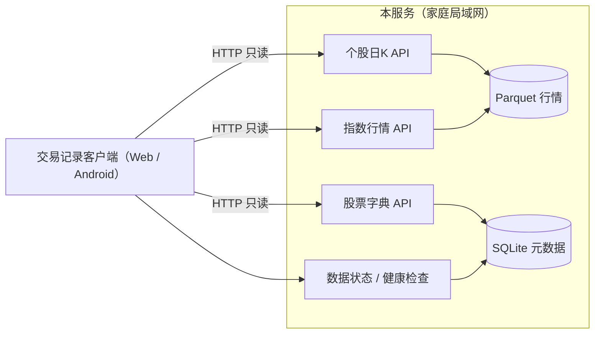

# 行情数据服务规划

> 定位：部署在家庭局域网内的**只读行情服务**，为交易记录与复盘客户端提供股票字典、日K、指数区间与数据新鲜度。  
> 技术基线：Python 3.10+ / FastAPI / SQLite 元数据 / Parquet 行情 / 无鉴权单用户。  
> 客户端配套规划：`everything/docs/交易记录与复盘产品规划.md`  
> 本文是规划建议，不是最终设计。任何实现前必须先更新 `docs/设计方案.md`，评审通过后再动手。

---

## 1. 职责边界

### 1.1 本期承担

| 能力 | 说明 |
|---|---|
| 股票字典 | 代码、名称、行业；供客户端搜索与**离线导入时本地映射** |
| 日K | 单股区间 raw/qfq/hfq 三组价量 |
| 指数行情 | 指数区间收盘序列，供客户端做基准对比 |
| 数据状态 | 数据集覆盖日期、滞后天数、健康检查 |

### 1.2 明确不做

- **不做截图解析**：已确认客户端端上离线识别，截图不上传服务端。
- **不存储交易记录**：交易数据留在客户端，本期不上服务端。
- **不计算收益与行为指标**：口径在客户端 `stats.ts`，服务端不复制。
- **不生成复盘报告**：报告由客户端组装。
- **不做登录/多用户/公网部署**：保持本地单人使用定位。
- **不改动既有抓取与策略脚本**：`script/`、`strategy/strategy/` 保持只读。

### 1.3 为什么服务端只做行情

用户已确认“截图最好离线解析”。这让服务端职责显著收窄：

- 截图隐私风险从服务端彻底移除；
- 无需引入 OCR 引擎、上传队列、临时文件与清理机制；
- 服务端只承担“客观行情事实”，与客户端“分析/报告”解耦；
- 后续若端上精度不达标，再单独立项评估“用户显式开启的服务端兜底”，默认不做。



---

## 2. 现状基线

| 用途 | 接口 | 现状 | 备注 |
|---|---|---|---|
| 股票搜索 | `GET /api/stocks?q=&limit=` | 已存在 | 按 code/名称模糊查询；`limit` 上限 2000 |
| 日K | `GET /api/stocks/{code}/kline?from=&to=` | 已存在 | 一次返回 raw/qfq/hfq |
| 数据覆盖 | `GET /api/datasets` | 已存在 | 含 `latest_data_date`、`lag_days` |
| 健康检查 | `GET /api/health` | 已存在 | 供客户端连接测试 |
| 任务状态 | `GET /api/tasks`、`GET /api/tasks/{id}` | 已存在 | 与客户端无直接关系 |

现有约束：

- 服务默认 `127.0.0.1:8000`，CORS 仅本机来源。
- 无鉴权、单用户，不可公网暴露。
- 主数据是 Parquet，SQLite 只存元数据。
- 不引入 Celery/Redis/多进程调度等重组件。
- 日志 UTF-8，注释中文。

---

## 3. 家庭局域网访问

### 3.1 部署形态

```
家庭局域网
├─ 运行 lianghua 的电脑 / NAS（固定局域网 IP，如 192.168.1.10:8000）
├─ 手机 Android App（同一 Wi-Fi）
└─ 浏览器 Web（同一 Wi-Fi，开发时 localhost:8081）
```

客户端在设置页填写服务地址（如 `http://192.168.1.10:8000`），不写死。Android 端不能用 `localhost`，否则指向手机自身。

### 3.2 网络与安全（硬性）

1. **仅局域网**：不做公网端口映射、反向代理、域名绑定；无鉴权前提下禁止公网暴露。
2. 需要远程访问时，只用 Tailscale / WireGuard 等私有网络。
3. CORS 使用**明确白名单**，不得 `*`。
4. 监听地址改为配置项：默认 `127.0.0.1`，局域网模式显式改为 `0.0.0.0`。
5. 建议在路由器为服务主机保留固定 IP（DHCP 绑定），避免客户端地址频繁失效。
6. 错误信息不返回本地绝对路径、行情文件路径等内部细节。

### 3.3 配置建议

实现时以设计文档为准，建议增加：

```yaml
trade_api:
  enabled: true
  # 局域网模式改为 0.0.0.0；默认仍仅本机
  bind_host: 127.0.0.1
  cors_origins:
    - http://localhost:8081
    - http://127.0.0.1:8081
    # 局域网 Web 访问时按实际地址补充
    # - http://192.168.1.10:8081
  stock_snapshot:
    # 客户端离线股票字典的刷新建议周期
    refresh_hint_hours: 168
```

Android 原生请求不受 CORS 限制，但仍需保证手机与主机在同一网段且防火墙放行 8000 端口。

---

## 4. API 规划

### 4.1 复用现有接口

客户端直接使用，不另建重复接口：

- `GET /api/health`
- `GET /api/stocks?q=&limit=`
- `GET /api/stocks/{code}/kline?from=&to=`
- `GET /api/datasets`

### 4.2 新增：股票字典快照

**为什么需要**：客户端离线识别截图后，需要用本地字典把“股票名称”映射为代码。逐个搜索在离线时不可用，且现有列表接口 `limit` 上限 2000，覆盖不了全部 A 股。

```
GET /api/tradetrace/v1/market/stocks/snapshot
```

响应：

```json
{
  "schema_version": 1,
  "generated_at": "2026-10-23T18:00:00+08:00",
  "count": 5230,
  "stocks": [
    { "code": "600519", "name": "贵州茅台", "market": "SH", "industry": "白酒" }
  ]
}
```

约定：

- 只返回代码、名称、市场、行业，不含价格等易变字段。
- 体积控制在数百 KB 量级，客户端缓存到本地。
- 数据源为空时返回空数组并给出 `generated_at`，不造假值。
- 客户端按 `generated_at` 决定是否需要刷新，不强制每次启动拉取。

### 4.3 新增：指数区间行情

```
GET /api/tradetrace/v1/market/index/kline?code=sh000300&from=2026-01-01&to=2026-10-23
```

响应：

```json
{
  "schema_version": 1,
  "code": "sh000300",
  "name": "沪深300",
  "dates": ["2026-01-02"],
  "open": [3960.0],
  "high": [4001.2],
  "low": [3950.1],
  "close": [3980.12],
  "volume": [123456789]
}
```

约定：

- 复用现有指数存储与读取逻辑，不新建数据管道。
- 指数无复权概念，直接返回收盘序列；客户端在报告中标注“指数对比不含分红再投资”。
- 区间上限与单股日K一致，过大直接 422 并提示缩小范围。
- 指数代码与名称复用现有配置中的指数清单。

### 4.4 契约规范

- 所有响应带 `schema_version`。
- 错误统一为 `{ code, message, detail }`；客户端只按 `code` 分支。
- HTTP 语义：400 参数、404 不存在、422 业务校验、500 内部错误。
- 新增字段保持向后兼容；破坏性变更走新版本路径。

---

## 5. 缓存、数据新鲜度与降级

| 项 | 服务端 | 客户端 |
|---|---|---|
| 日K | 直接读 Parquet，不做复杂缓存；热点可加进程内 LRU | 按 `code + 区间 + 复权` 缓存，带 TTL |
| 股票字典 | 快照接口，按请求生成或短时缓存 | 本地持久化，按 `generated_at` 刷新 |
| 指数 | 同上 | 同上 |
| 新鲜度 | `/api/datasets` 返回覆盖日期与滞后 | 展示“数据截至 X 日”；过期时提示 |
| 降级 | 服务不可达时客户端读缓存 | 显式标注“未连接行情”，不伪造数据 |

服务端不维护客户端缓存状态，不引入 Redis 等组件。

---

## 6. 非功能要求

| 维度 | 要求 |
|---|---|
| 性能 | 单股一年日K p95 < 300ms；股票字典快照 p95 < 1s |
| 并发 | 单用户家庭场景，行情查询可并发；读 Parquet 无写冲突 |
| 资源 | 大区间请求限制范围；避免一次性加载全部 Parquet 到内存 |
| 稳定性 | 服务重启无悬挂状态；`/api/health` 可用于客户端探活 |
| 可观测 | 记录请求路径、耗时、错误码；不记录客户端交易内容（本来也拿不到） |
| 兼容 | 不破坏既有 `/api/*` 接口与平台前端 |

---

## 7. 路线图

| 阶段 | 主题 | 交付物 | 完成标志 |
|---|---|---|---|
| **L1** | 局域网可用 | 绑定地址配置、CORS 白名单、健康检查验证 | 手机/浏览器在同一 Wi-Fi 可访问；默认仍仅本机 |
| **L2** | 客户端所需数据 | 股票字典快照、指数区间接口 | 客户端可离线映射股票、可拉取基准数据 |
| **L3（可选）** | 服务端解析兜底 | 仅在端上精度长期不达标且用户明确开启时评估 | 单独立项，默认不做 |
| **L4（可选）** | 交易数据集中存储 | 鉴权、实体级合并、迁移方案 | 单独立项评审，不在本期 |

排序理由：L1 是客户端 P1 的前置；L2 同时支撑客户端 P1（股票选择）与 P2（离线代码映射）；L3/L4 涉及隐私与鉴权，必须单独评审。

---

## 8. 测试与验收

| 类型 | 内容 |
|---|---|
| 单元测试 | 快照生成、指数区间读取、区间参数校验、错误码 |
| 接口测试 | 既有接口不回归；新增接口结构、`schema_version`、空数据 |
| 网络测试 | `127.0.0.1` 默认模式；局域网模式监听；CORS 白名单命中与拒绝 |
| 安全测试 | 无通配 CORS；错误信息不含绝对路径；大区间拒绝 |
| 启动自检 | `uvicorn app.main:app --host 127.0.0.1 --port 8000` 可启动；`/api/health` 正常；关键接口可调 |

验收口径：

- 手机与浏览器在同一局域网可完成健康检查、股票搜索、日K、指数查询。
- 股票字典快照覆盖实际股票表数量，`count` 与内容一致，无占位数据。
- 默认配置下服务仍只监听本机。
- 既有平台页面与接口不受影响。

---

## 9. 风险与缓解

| 风险 | 等级 | 缓解 |
|---|---|---|
| 无鉴权被公网暴露 | 高 | 默认 127.0.0.1；文档明示仅局域网/VPN；CORS 白名单 |
| 家庭 IP 变化导致客户端失联 | 中 | 路由器固定 IP / DHCP 绑定；客户端可随时改地址并测试 |
| 股票字典快照过期 | 中 | 返回 `generated_at`；客户端提示刷新；不阻塞离线导入（失败可手动选股） |
| 指数数据缺失 | 中 | 返回空序列并标注；客户端报告降级，不伪造基准 |
| 大区间查询拖慢服务 | 中 | 限制区间与返回行数，超限 422 |
| 新增接口破坏既有设计 | 中 | 先改 `docs/设计方案.md`；新增路径不改既有语义 |
| Parquet 读取内存峰值 | 中 | 限制范围、流式/分批读取，不做全量加载 |

---

## 10. 决策记录与待确认事项

### 10.1 已确认

| 编号 | 问题 | 结论 |
|---|---|---|
| D-A | 部署与访问方式 | **家庭局域网**，服务部署在家里；客户端配置服务地址 |
| D-B | 截图解析位置 | **客户端端上离线解析**，服务端不接收截图 |
| D-C | 首期券商 | **仅同花顺**（17 张样本已提供）；雪球、腾讯自选股暂缓；模板由客户端维护，服务端无感知 |

### 10.2 仍需确认

| 编号 | 问题 | 建议默认 |
|---|---|---|
| Q1 | 服务主机是否固定局域网 IP？ | 是；路由器 DHCP 绑定 |
| Q2 | 是否需要 Web 端局域网访问？ | 需要；CORS 按实际地址补充 |
| Q3 | 指数清单用哪些代码？ | 复用现有 `report_index_codes` |
| Q4 | 股票字典快照是否包含行业字段？ | 包含，便于客户端展示 |
| Q5 | 是否需要服务端解析兜底？ | 暂不需要，默认关闭 |
| Q6 | 数据新鲜度是否新增聚合接口？ | 暂不；复用 `/api/datasets` |

---

## 11. 实施纪律（硬性）

1. **设计文档先行**：实现前先更新 `docs/设计方案.md`，写入接口、配置项与监听策略。
2. **分支**：平台相关改动统一在 `platform` 分支提交，不推送 `main`。
3. **只读资产**：`script/` 与 `strategy/strategy/` 不改逻辑；确需参数化时先记录适配清单并备份。
4. **不引入重组件**：无 Celery/Redis/登录鉴权/多进程调度。
5. **数据不造假**：股票数量、日期、覆盖度均由实际数据计算。
6. **交付必须实测**：启动服务、调用新增与既有接口、验证局域网访问与 CORS，并给出实际结果。
